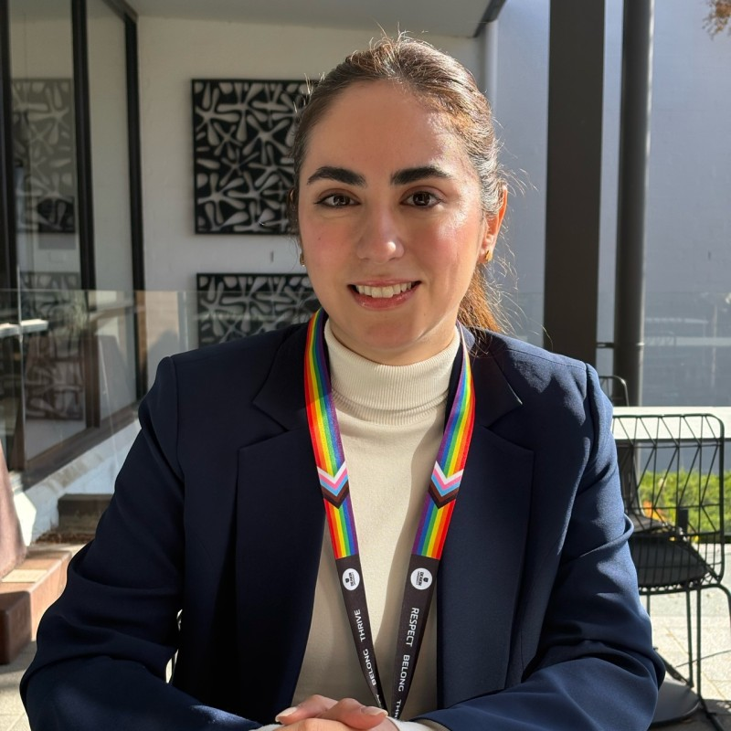

## Evaluating AI Agents with LLM-as-a-Judge {#welcome .intro-slide .welcome-slide .section-divider .part-title .sd-7 style="--deck-heading: var(--sd-on-ink); --deck-ink: var(--sd-on-ink); --deck-soft: var(--sd-on-ink); --deck-accent: var(--sd-on-ink); --deck-accent-strong: var(--sd-on-ink); --deck-line: var(--sd-on-ink); --deck-gradient: linear-gradient(var(--sd-on-ink), var(--sd-on-ink));"}

<!-- TODO: housekeeping (emergency exits, toilets, Wi-Fi, recording) goes in the notes only. Fill the prompts there before the day. -->

```{=html}
<p class="iw-kicker">Welcome · ALTA 2026 · Tutorial 2</p>
<div class="iw-rule" aria-hidden="true"></div>
<p class="iw-when">Afternoon tutorial · Monday 30 November 2026</p>
<p class="iw-where">Deakin Downtown, Melbourne</p>
<p class="iw-people">Parvin Zarei Eskikand · Terrence Szymanski · Sara Mirabi · Yelaman Abdullin</p>
<p class="iw-site">Slides, the hands-on app and the reading list: <a href="https://tdszyman.github.io/alta2026-evaluating-ai-agents/">tdszyman.github.io/alta2026-evaluating-ai-agents</a></p>
```

::: {.notes}
**About this slide:** Welcome to Tutorial 2 of ALTA 2026, the afternoon tutorial on the tutorial day: Evaluating AI Agents with LLM-as-a-Judge. The tutorial is about how to evaluate AI agents, which plan, use tools and talk with users, and in particular how to use a language model as the judge. This short intro covers the plan for the afternoon and the four presenters, then goes straight into Part 1.

**What to take away:** Which tutorial this is, who is presenting, and that everything on the slides is also on the tutorial site.

**Presenter notes:**

- Housekeeping. TODO for the speakers: fill each line from the venue or the ALTA organisers before the day, then say it here. Do not put it on the slide.
  - TODO: emergency exits and the assembly point.
  - TODO: where the toilets are.
  - TODO: Wi-Fi network and password, if the venue provides one. Part 3 needs a connection.
  - TODO: whether this session is recorded or photographed. ALTA’s registration page says registration includes “Access to all recorded sessions”; it does not say which sessions are recorded.
  - TODO: anything else the ALTA organisers ask presenters to announce.
- The site link is there so people can open the slides and the hands-on app on their own laptops.
- Sources: the title, “Tutorial 2”, the afternoon slot, the date and the presenters’ names, in the programme’s order, are from the ALTA 2026 programme page (https://alta2026.alta.asn.au/program#afternoon-tutorial, read 6 November 2026; also `knowledge/tutorial-overview.md`). The venue, Deakin Downtown (Level 12, Tower 2, Collins Square, 727 Collins St, Docklands), is from the ALTA 2026 home and venue pages (https://alta2026.alta.asn.au/venue/).
:::

---

## This afternoon: two sessions, four parts {#the-afternoon .intro-slide .timeline-slide}

<!-- Schedule from Terrence, 6 Nov 2026. Items he marked "??" are wrapped in <span class="tbc">; when one is confirmed, remove its span, and when none are left, remove the legend from the source line. -->

```{=html}
<div class="tl-grid">
  <ol class="tl-rows">
    <li class="tl-session"><span class="tl-time"></span><span class="tl-what"><b>Session 1</b> · Foundations of AI Agent Evaluation</span><span class="tl-len">1.5 h</span></li>
    <li class="tl-part"><span class="tl-time"><span class="tbc">1:00</span></span><span class="tl-what"><b>Part 1</b> AI Agents and Evaluation Challenges<span class="tl-who">Terrence Szymanski</span></span><span class="tl-len">45 min</span></li>
    <li class="tl-part"><span class="tl-time">1:45</span><span class="tl-what"><b>Part 2</b> LLM-as-a-Judge Methods<span class="tl-who">Parvin Zarei Eskikand</span></span><span class="tl-len">45 min</span></li>
    <li class="tl-break"><span class="tl-time">2:30</span><span class="tl-what">Afternoon tea</span><span class="tl-len"><span class="tbc">30 min</span></span></li>
    <li class="tl-session"><span class="tl-time"></span><span class="tl-what"><b>Session 2</b> · Practical Evaluation of AI Agents</span><span class="tl-len">1.5 h</span></li>
    <li class="tl-part tl-hands"><span class="tl-time">3:00</span><span class="tl-what"><b>Part 3</b> Hands-on Agent Evaluation Exercise <span class="tl-tag">Laptop</span><span class="tl-who">Yelaman Abdullin · 10-minute intro, then the hands-on exercise</span></span><span class="tl-len">60 min</span></li>
    <li class="tl-part"><span class="tl-time">4:00</span><span class="tl-what"><b>Part 4</b> Reliability, Limitations, and Future Directions<span class="tl-who">Sara Mirabi</span></span><span class="tl-len">30 min</span></li>
    <li class="tl-break"><span class="tl-time"><span class="tbc">4:30</span></span><span class="tl-what">End</span><span class="tl-len"></span></li>
  </ol>
  <div class="tl-callout">
    <p class="tl-kicker">Part 3 is hands-on</p>
    <p class="tl-big">Bring a laptop</p>
    <p>You will write a rubric and an LLM judge for a tool-using agent, then run it over test cases.</p>
    <p>It runs in a web browser. Open it from <b>Hands-on</b> on the tutorial site.</p>
    <p>LLM access is built in; no setup needed.</p>
  </div>
</div>
<p class="tl-src slide-foot">Times as planned on 6 November 2026. Session lengths: ALTA 2026 programme. <span class="tbc">Dotted underline</span>: to be confirmed.</p>
```

::: {.notes}
**About this slide:** The plan for the afternoon, from 1:00 to 4:30. Session 1, Foundations of AI Agent Evaluation, has Part 1, AI Agents and Evaluation Challenges, at 1:00, and Part 2, LLM-as-a-Judge Methods, at 1:45, 45 minutes each. Afternoon tea is at 2:30. Session 2, Practical Evaluation of AI Agents, has Part 3, the hands-on exercise, at 3:00 for an hour, starting with a 10-minute intro, and Part 4, Reliability, Limitations, and Future Directions, at 4:00 for half an hour. Part 3 is hands-on: participants write a rubric and an LLM judge for a tool-using agent and run it over test cases, so bring a laptop.

**What to take away:** When the break is, and that Part 3 needs a laptop with a web browser.

**Presenter notes:**

- The times are Terrence’s schedule as planned on 6 November 2026. Three items are not confirmed and have a dotted underline on the slide: the 1:00 start, the 30-minute afternoon tea and the 4:30 end. Check them with the ALTA organisers before the day.
- There is no separate slot for this Intro, so it comes out of Part 1’s 1:00–1:45. TODO: confirm that, and how long the Intro may take.
- Presenters (Terrence, 6 November 2026): Part 1 Terrence, Part 2 Parvin, Part 3 Yelaman, Part 4 Sara. Part 3 starts with a 10-minute intro presentation from Yelaman, then the hands-on exercise, within its 60 minutes.
- LLM access is built into the hands-on site, so participants do not need to set anything up (Terrence, 6 November 2026). The programme had said “Access to the required LLM will be arranged and confirmed before the tutorial.”
- TODO: what to say to people without a laptop. The programme says “Participants should bring a laptop for the hands-on exercises.” The organisers’ working direction from 23 October is to assume laptops are optional.
- Sources for every time on the slide:
  - Start times and lengths of Parts 1–4, afternoon tea and the end: Terrence’s schedule as planned on 6 November 2026. Not confirmed, so not in `knowledge/`.
  - Session 1 (Parts 1 and 2) is 1.5 hours and Session 2 (Parts 3 and 4) is 1.5 hours: ALTA 2026 programme page, “Tutorial Overview” for the afternoon tutorial (https://alta2026.alta.asn.au/program#afternoon-tutorial, read 6 November 2026), recorded in `knowledge/tutorial-overview.md`. That schedule agrees: 1:00–2:30 and 3:00–4:30.
  - The programme page itself gives no clock times and no break; it says “The full conference program with a detailed schedule will be released at a later date.”
- The Part 3 description is the programme’s: “Participants develop a rubric and LLM judge for a practical tool-using agent scenario, run the judge over test cases, and analyse outcomes”.
:::

---

## Your presenters {#presenters .intro-slide .presenters-slide}

<!-- TODO: photos and logos. Only Terrence’s photo is on the slide. Ask each other presenter for a photo and permission to publish it on the public site, and check logo permissions with SEEK, Deakin University and Macquarie University before adding any. -->

```{=html}
<div class="pc-grid">
  <article class="pc-card fragment" data-fragment-index="1">
    
    <p class="pc-name">Terrence Szymanski</p>
    <p class="pc-role">Head of Generative AI, SEEK</p>
    <div class="pc-bio">
      <p>PhD Linguistics, <a href="https://lsa.umich.edu/linguistics">Michigan</a>. Postdoc at <a href="https://www.insight-centre.org/">Insight Centre</a>, <a href="https://www.ucd.ie/">UCD</a>. Research in ML, NLP, computational morphology, computational semantics.</p>
      <p>10+ years of industry data science experience at ANZ and SEEK. Currently leading the Generative AI centre of excellence team and building agentic AI products at SEEK.</p>
    </div>
    <p class="pc-part">Presents Part 1</p>
  </article>
  <article class="pc-card fragment" data-fragment-index="2">
    <div class="pc-photo" aria-hidden="true">PZE<span class="todo">Photo</span></div>
    <p class="pc-name">Parvin Zarei Eskikand</p>
    <p class="pc-role">Senior Data Scientist, SEEK</p>
    <ul class="pc-bio">
      <li>PhD in Biomedical Engineering, University of Melbourne: computational models of the visual cortex</li>
      <li>Postdoctoral research, University of Melbourne: neural models of the enteric nervous system, then epileptic seizure prediction</li>
    </ul>
    <p class="pc-part">Presents Part 2</p>
  </article>
  <article class="pc-card fragment" data-fragment-index="3">
    <div class="pc-photo" aria-hidden="true">YA<span class="todo">Photo</span></div>
    <p class="pc-name">Yelaman Abdullin</p>
    <p class="pc-role">Senior AI Engineer, StarRez</p>
    <div class="pc-bio">
      <p>Recent PhD graduate, Macquarie University. Research interests in NLP, machine learning, and AI.</p>
      <p>10+ years in industry across engineering and tech leadership roles. Currently integrating AI features at StarRez, focusing on harnesses, evals, and AI engineering.</p>
    </div>
    <p class="pc-part">Presents Part 3</p>
  </article>
  <article class="pc-card fragment" data-fragment-index="4">
    
    <p class="pc-name">Sara Mirabi</p>
    <p class="pc-role">PhD Candidate, School of Information Technology, Deakin University</p>
    <ul class="pc-bio">
      <li>10+ years of industry experience as a software programmer and technology solution provider, with expertise in systems integration, automation, and applied machine learning</li>
    </ul>
    <p class="pc-part">Presents Part 4</p>
  </article>
</div>
<div class="pc-foot slide-foot">
  <p class="pc-src">Roles: ALTA 2026 programme. Bios: sources in the notes.</p>
  <a class="next-deck" data-next-deck href="../01-agents-and-eval-challenges/">Next: Part 1 · AI Agents and Evaluation Challenges →</a>
</div>
```

::: {.notes}
**About this slide:** The four presenters, in the order they present, from industry and from university research. Terrence Szymanski presents Part 1. He did a PhD in linguistics at the University of Michigan and a postdoc at the Insight Centre for Data Analytics, University College Dublin, with research in ML, NLP, computational morphology and computational semantics. He has more than 10 years of industry data science experience at ANZ and SEEK, and is Head of Generative AI at SEEK, where he leads the Generative AI centre of excellence team and builds agentic AI products. Parvin Zarei Eskikand presents Part 2. She is a Senior Data Scientist at SEEK; her PhD at the University of Melbourne built computational models of the visual cortex, and her postdoctoral research there modelled the enteric nervous system and then worked on predicting epileptic seizures. Yelaman Abdullin presents Part 3, the hands-on exercise. He is a Senior AI Engineer at StarRez and a recent PhD graduate from Macquarie University, with interests in NLP, machine learning and AI; before his PhD he spent a decade in industry as an engineer and tech lead, and at StarRez he builds AI product features with a focus on harnesses, evals and AI engineering. Sara Mirabi presents Part 4. She is a PhD candidate in the School of Information Technology at Deakin University, with more than 10 years of industry experience in software engineering, systems integration, automation and applied machine learning.

**What to take away:** Two presenters build and evaluate AI agents at SEEK; two research LLM-based dialogue at Deakin and Macquarie.

**Presenter notes:**

- Each click shows one presenter. That presenter stands up and waves, and can add a sentence; the current card is highlighted. Order is presenting order (Terrence, 6 November 2026): Terrence (Part 1), Parvin (Part 2), Yelaman (Part 3), Sara (Part 4).
- After the last card, the link at the bottom right goes to Part 1. Going forward from the end of this deck (right arrow, space or the top bar’s next button) also opens Part 1, which Terrence presents. From the speaker view, click the link.
- Terrence’s photo is the one on the ALTA 2023 keynotes page (https://alta2023.alta.asn.au/assets/images/keynotes/Terry.jpg), added at his request on 21 November 2026. The same file is on the About page.
- TODO: photos. The other three cards have a placeholder. Ask each presenter for a photo and for permission to publish it, because the deck is on the public site.
- TODO: logos. None are used. Part 1’s “About me, and SEEK” slide shows official University of Michigan, UCD and ANZ marks, and its notes say those institutions restrict outside use. Check permission with SEEK, Deakin University and Macquarie University before adding theirs.
- TODO: each presenter to check their card. The bios below are only what public pages say; anyone can replace theirs with their own wording.
- Sources:
  - Roles as published on the ALTA 2026 programme page (https://alta2026.alta.asn.au/program#afternoon-tutorial, read 6 November 2026): Parvin Zarei Eskikand (Senior Data Scientist, SEEK), Terrence Szymanski (Head of Generative AI, SEEK), Sara Mirabi (Deakin University), Yelaman Abdullin (Macquarie University). Also in `knowledge/tutorial-overview.md`.
  - Terrence: the card text is his own short bio, supplied 21 November 2026; his full bio, supplied the same day, is on the About page (`presentations/about/index.qmd`). At his request (21 November 2026) the card shortens the affiliations to “Michigan” and “Insight Centre, UCD”, linked to the U-M Linguistics department (https://lsa.umich.edu/linguistics), the Insight Centre (https://www.insight-centre.org/) and UCD (https://www.ucd.ie/). It agrees with Part 1’s “About me, and SEEK” slide (`presentations/presentation/01-agents-and-eval-challenges/index.qmd`), whose background Terrence supplied: BSE and BA, then a PhD in Linguistics, at the University of Michigan; a postdoc at the Insight Centre for Data Analytics, University College Dublin; Data Scientist at ANZ (Institutional Banking) and at SEEK (Candidate Quality); now Head of Generative AI at SEEK.
  - Parvin: her profile on the ARC Training Centre in Cognitive Computing for Medical Technologies site (https://aimedtech.org.au/people/Parvin%20Zarei-Eskikand.html): PhD in 2017 in the Department of Biomedical Engineering at the University of Melbourne, “a computational model of the visual cortex particularly focusing on Medial Temporal area”; a postdoc in the University of Melbourne’s Department of Physiology, “a multiscale neural model of the enteric nervous system”; joined the ARC Training Centre in July 2019 to work on predicting epileptic seizures. The profile predates her SEEK role and still lists her as Research Fellow, Epilepsy Brain Modelling, The University of Melbourne. The thesis is “Computational models of V1 and MT neurons for estimation of visual motion direction” (University of Melbourne, Minerva Access, http://hdl.handle.net/11343/140336).
  - Sara: her Deakin University expert profile (https://experts.deakin.edu.au/65017-sara-mirabi): Graduate Researcher, Faculty of Science Engineering and Built Environment, School of Information Technology; areas of expertise “Machine learning, deep learning and software engineering” and “Natural language processing and speech recognition”. Paper: Sara Mirabi, Bahadorreza Ofoghi, John Yearwood, Diego Mollá and Vicky Mak-Hau. 2025. Investigating Answer Validation Using Noise Identification and Classification in Goal-Oriented Dialogues. In *Proceedings of ICAART 2025*, pages 658–669 (https://doi.org/10.5220/0013304000003890).
  - Yelaman: card and About-page bio supplied by Yelaman on 24 November 2026 (Senior AI Engineer at StarRez; recent PhD graduate from Macquarie University; decade of prior engineering and tech leadership experience; interests in NLP, ML and AI; working on AI product features, harnesses, evals and AI engineering). ALTA programme lists Macquarie University.
- Not on the slide, because the only sources are self-published or informal: Parvin’s LinkedIn says she joined SEEK’s Generative AI team in December 2025. TODO: Parvin to confirm her bio and photo; Yelaman to supply a photo if desired.
:::
